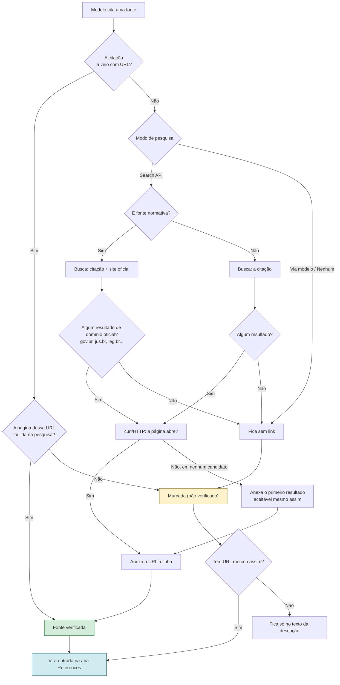
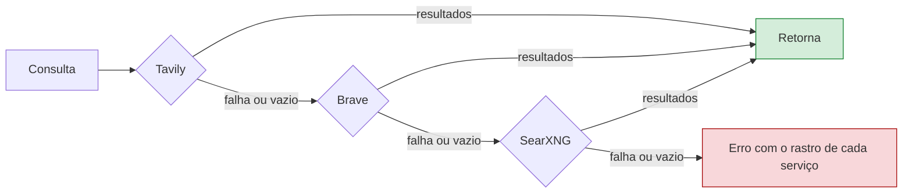
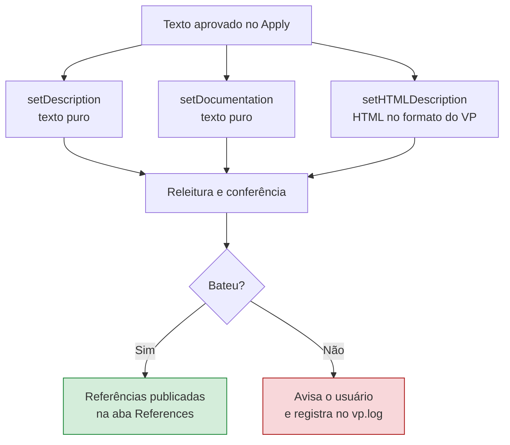

# Documentação de classes por Inteligência Artificial

Esta funcionalidade escreve — ou melhora — a documentação de uma classe do modelo, seguindo um
template fixo e apoiada em pesquisa na web, dando preferência a fontes oficiais.

A pesquisa tem duas etapas, e elas não se confundem: os **serviços de busca** servem para transformar
os termos da classe em páginas candidatas, e **cada página encontrada é então baixada** — por HTTP
direto e, quando isso não passa, por `curl` — para que o modelo trabalhe sobre o que a página diz, e
não sobre o trecho que o buscador escreveu para anunciá-la.

Acesso: botão direito sobre uma classe → **Document or improve documentation...**

O texto gerado vai para o campo *Description* da classe, e as fontes citadas que tenham URL viram
entradas na aba **References** do Visual Paradigm.

---

## 1. O template

A estrutura preenchida pela IA é configurável em *Settings → Prompts & decision tree… → Documentation*
(veja a [seção 6](#6-configuração)). O padrão fica em
[`src/main/resources/prompts/`](../src/main/resources/prompts/README.md), junto com os demais prompts da IA, e é:

```markdown
# {Nome da Classe}

## Descrição curta
{No máximo 40 palavras.}

## Descrição completa
{Tamanho livre.}

## Fontes Normativas
{Leis, Documentações Oficiais, Resoluções...}

## Fontes
{Blogs, Livros e Documentos explicativos}
```

Duas regras de formatação valem a pena registrar:

- **Seções de fontes vazias são removidas.** Se não houver fonte normativa defensável, o cabeçalho
  "Fontes Normativas" não aparece. O prompt pede isso, e o código remove o que sobrar.
- **O estereótipo OntoUML nunca aparece no texto.** Ele é enviado à IA como contexto para que ela
  entenda a natureza da coisa, mas o prompt proíbe citá-lo: o leitor é do domínio, não modelador.

---

## 2. O fluxo completo

```mermaid
sequenceDiagram
    actor U as Usuário
    participant VP as Visual Paradigm
    participant C as DocumentClassController
    participant W as DocumentClassWorker
    participant CB as LlmPromptContextBuilder
    participant F as WebPageFetcher
    participant S as WebSearchController
    participant L as LlmAccessController
    participant V as DocumentClassView

    U->>VP: botão direito → Document or improve documentation...
    VP->>C: performAction(contexto)
    C->>C: valida seleção única e provedor configurado
    C->>W: execute()

    Note over W: tudo abaixo roda fora da EDT,<br/>com diálogo de progresso cancelável

    W->>CB: buildDocumentationClassSummary(classe)
    CB-->>W: nome, estereótipo, atributos e<br/>descrição atual (íntegra)

    W->>CB: buildRelatedClassesSummary(classe)
    CB-->>W: vizinhas com descrição CURTA<br/>+ fontes normativas já citadas

    rect rgb(245, 245, 220)
        Note over W,L: Etapa RAG — lê as fontes das classes vizinhas
        W->>CB: collectRelatedSources(classe)
        CB-->>W: referências da aba References das vizinhas
        loop até 8 fontes
            W->>F: fetch(url) — HTTP direto, depois curl
            F-->>W: texto da página (≤ 6000 chars) ou null
            alt link morto e modo Search API
                W->>S: findRetrievablePage(legenda da fonte)
                S->>F: fetch(candidato)
                F-->>S: texto de outra página com a mesma referência
                S-->>W: página alternativa lida
            end
            alt conteúdo obtido
                W->>L: requestSourceSummary(conceito, fonte, conteúdo)
                L-->>W: resumo de 50 palavras focado na classe
            else sem conteúdo e sem busca via modelo
                Note over W: fonte é pulada — resumir<br/>de memória seria inventar
            end
        end
    end

    opt modo Search API
        Note over W,F: a busca encontra as páginas;<br/>quem lê o texto é o fetcher
        W->>S: search(consultas do nome + projeto)
        S-->>W: candidatos (título, URL, trecho)
        W->>S: deduplicate + retrieve(candidatos)
        loop até 5 páginas
            S->>F: fetch(url)
            F-->>S: texto da página (≤ 2500 chars) ou null
        end
        S-->>W: candidatos com o texto lido<br/>(quem não abriu fica só com o trecho)
    end

    W->>L: requestDocumentation(prompt montado)
    L-->>W: template preenchido

    opt modo Search API
        W->>S: resolveUrl(fonte sem link)
        S->>F: fetch(candidato) — confirma que a página abre
        F-->>S: texto ou null
        S-->>W: URL oficial que foi lida, se encontrada
    end
    W->>W: remove seções de fontes vazias

    W->>V: mostra proposta ao lado da atual
    U->>V: revisa, edita se quiser, clica Apply
    V-->>W: wasApplied() = true

    W->>VP: setDescription + setDocumentation + setHTMLDescription
    W->>VP: addReference() por fonte com URL
    W->>W: relê e confirma a gravação
```

---

## 3. As classes envolvidas

```mermaid
classDiagram
    class DocumentClassController {
        <<VPContextActionController>>
        +performAction(action, context, event)
        +update(action, context)
        -getSingleSelectedClass(context) IClass
    }

    class DocumentClassWorker {
        <<SwingWorker>>
        -MAX_SOURCE_SUMMARIES = 8
        +doInBackground() SuggestionResult
        -summariseRelatedSources(config) String
        -researchSection(config) String
        -resolveMissingUrls(config, doc) String
        -writeDescription(classe, doc) boolean
        -toHtml(texto) String
    }

    class LlmPromptContextBuilder {
        -MAX_DESCRIPTION_LENGTH = 1500
        +buildDocumentationClassSummary(classe) String
        +buildRelatedClassesSummary(classe) String
        +collectRelatedSources(classe) List~RelatedSource~
    }

    class DocumentationTemplate {
        +parse(descrição) DocumentationTemplate
        +withoutEmptySourceSections(doc) String
        +urlOf(linha) String
        +captionOf(linha) String
        +getShortDescription() String
        +getNormativeSources() List~String~
    }

    class LlmAccessController {
        +requestDocumentation(config, nome, prompt) SuggestionResult
        +requestSourceSummary(config, conceito, fonte, url, conteúdo) String
        +testConnection(config) String
        +testModelSearch(config) String
    }

    class WebSearchController {
        -DEFAULT_MAX_RESULTS = 6
        -DEFAULT_MAX_PAGES = 5
        -MAX_PAGE_CHARACTERS = 2500
        -TIMEOUT_MILLIS = 20000
        +search(config, consulta, max) List~SearchResult~
        +deduplicate(resultados) List~SearchResult~
        +retrieve(config, resultados, max) int
        +findRetrievablePage(config, termo) SearchResult
        +resolveUrl(config, citação, exigirOficial) String
        +format(resultados) String
        +isOfficial(url) boolean
    }

    class WebPageFetcher {
        -MAX_CHARACTERS = 6000
        -TIMEOUT_MILLIS = 15000
        +fetch(url) String
        +fetch(url, maxCaracteres) String
        +isRetrievable(url) boolean
        -fetchOverHttp(url) Retrieval
        -fetchWithCurl(url) String
        -decode(bytes, contentType) String
        -toPlainText(html, max) String
    }

    class SearchResult {
        +getTitle() String
        +getUrl() String
        +getSnippet() String
        +getContent() String
        +hasContent() boolean
    }

    class ClassReferences {
        +addFrom(classe, doc) int
        +countLinkable(doc) int
    }

    class DocumentClassView {
        <<IDialogHandler>>
        +wasApplied() boolean
        +getDocumentation() String
        +shouldAddReferences() boolean
    }

    class LlmPromptResources {
        +getDocumentationPrompt() String
        +getDocumentationTemplate() String
        +getDefaultDocumentationPrompt() String
    }

    class LlmConfigurations {
        +getSearchMode() SearchMode
        +getUsableSearchProviders() List~SearchProvider~
        +getSearchCredential(provedor) String
        +isSearchUsable() boolean
    }

    class RelatedSource {
        +getOriginClass() String
        +getCaption() String
        +getUrl() String
        +getRetrievedFrom() String
        +wasRetrievedElsewhere() boolean
        +getSummary() String
    }

    DocumentClassController ..> DocumentClassWorker : dispara
    DocumentClassWorker ..> LlmPromptContextBuilder : monta contexto
    DocumentClassWorker ..> WebPageFetcher : lê as fontes já conhecidas
    DocumentClassWorker ..> WebSearchController : pesquisa termos e resolve URLs
    DocumentClassWorker ..> LlmAccessController : chama o modelo
    DocumentClassWorker ..> DocumentationTemplate : limpa e interpreta
    DocumentClassWorker ..> DocumentClassView : revisão do usuário
    DocumentClassWorker ..> ClassReferences : publica referências
    LlmPromptContextBuilder ..> DocumentationTemplate : extrai resumo das vizinhas
    LlmPromptContextBuilder ..> RelatedSource : coleta
    LlmAccessController ..> LlmConfigurations : provedor e credenciais
    WebSearchController ..> LlmConfigurations : serviços de busca
    WebSearchController ..> WebPageFetcher : lê cada página encontrada
    WebSearchController ..> SearchResult : preenche com o texto lido
    LlmPromptResources ..> LlmConfigurations : prompt customizado ou padrão
```



---

## 4. Como uma fonte ganha (ou não) o selo de verificada

Esta é a parte sensível: um LLM inventa citações jurídicas plausíveis com facilidade. O fluxo abaixo
existe para que isso não aconteça silenciosamente.



Regras que o prompt impõe e que sustentam esse fluxo:

- Uma URL só entra em **Fontes Normativas** se apareceu nos resultados de busca fornecidos, ou se já
  era citada como normativa por uma classe relacionada — com preferência para aquelas cuja página
  foi efetivamente baixada e lida.
- Um resultado que o buscador listou mas cuja página **não abriu** vale como memória, não como
  fonte: o trecho do buscador é propaganda da página, escrita para casar com a consulta.
- Sem pesquisa configurada, **toda** fonte listada carrega `(não verificado)`.
- Ao reutilizar a fonte de uma classe vizinha, a marca `(não verificado)` é **carregada junto** — uma
  referência não se torna verificada por ter sido copiada.
- Anexar uma URL encontrada por busca **não remove** a marca: achar a página da lei confirma a
  *fonte*, não que o artigo diga o que o texto afirma.

---

## 5. Modos de pesquisa

| Modo | Quem pesquisa | Resolve URL faltante? | Observação |
|---|---|---|---|
| **No research** | ninguém | não | Toda fonte sai marcada como não verificada |
| **Search via the model** | o provedor | **não** | Só funciona onde há suporte (OpenRouter via sufixo `:online`, modelos Perplexity/Sonar). Em outros provedores o modelo responde de memória |
| **Search API** | o plugin | **sim** | Único modo com garantia de que a fonte foi realmente lida |

A divisão de papéis dentro do modo **Search API** é deliberada:

| Etapa | Quem faz | O que entrega |
|---|---|---|
| Encontrar páginas a partir dos termos da classe | os serviços de busca | uma lista de candidatos: título, URL e trecho |
| Ler o que a página diz | `WebPageFetcher` — HTTP direto e, se não passar, `curl` | o texto da página, sem marcação, até 2500 caracteres no prompt |
| Achar outra cópia de uma referência cujo link morreu | os serviços de busca, e o fetcher em seguida | uma página alternativa, também lida antes de ser usada |

O trecho devolvido pelo buscador **nunca** substitui a leitura da página: ele entra no prompt apenas
quando a página não abriu, e marcado como tal.

No modo **Search API** é possível habilitar vários serviços — **Tavily**, **Brave** e **SearXNG**
(auto-hospedado). Eles são tentados na ordem da lista e, quando um falha, dá timeout (20 s) ou volta
vazio, o próximo assume:



Cada tentativa vira uma entrada no **AI Conversation Log**, então dá para ver qual serviço respondeu
e com quê.

> **SearXNG:** a saída JSON vem **desabilitada por padrão**. É preciso incluir `json` em `formats:`
> no `settings.yml` da instância, senão ela responde HTML e a busca falha.

---

## 6. Configuração

*OntoUML Plugin → Settings*, grupo **AI Metaclass Suggestion**:

- **Provider / API key / Base URL / Model** — endpoint compatível com OpenAI. Suporta OpenAI,
  Gemini, OpenRouter, Groq, Mistral, DeepSeek, Ollama e LM Studio (locais, sem chave), ou uma URL
  própria em *Other*.
- **Web research** — o modo da [seção 5](#5-modos-de-pesquisa), com os serviços e credenciais.
- **Test** e **Test search** — executam uma chamada real e **abrem o AI Conversation Log** com o que
  foi enviado e o que voltou, para validar a configuração.
- **Prompts & decision tree…** → aba **Documentation** — edita o *template* e o *prompt*, com
  **Restore defaults**. Salvar um texto idêntico ao padrão não grava customização, de modo que os
  padrões continuam evoluindo junto com o plugin.
  Os arquivos padrão e o passo a passo de personalização estão em
  [`src/main/resources/prompts/README.md`](../src/main/resources/prompts/README.md).

---

## 7. Onde o texto é gravado

O Visual Paradigm mantém a documentação de um elemento em mais de uma propriedade, e a janela
*Specification* renderiza a versão **HTML** quando ela existe. Por isso a gravação escreve nas três:



Escrever apenas o texto puro funcionava em classes ainda sem documentação, mas deixava o texto
antigo na tela em classes documentadas dentro do VP — cuja documentação está armazenada como HTML.

---

## 8. Limitações conhecidas

- **Resolução de URL só no modo Search API.** Nos demais modos, o plugin depende do que o modelo
  devolver.
- **Teto de 8 resumos** de fontes das classes vizinhas por execução — cada um é uma chamada de API.
- **Teto de 5 páginas lidas** por execução entre os resultados de busca, e de 3 candidatos abertos
  ao resolver a URL de uma citação: cada leitura é uma requisição HTTP.
- **Páginas truncadas em 6000 caracteres** antes de irem para o resumo, e em 2500 quando entram no
  prompt como resultado de busca.
- **PDFs não são lidos.** A extração é de marcação HTML; um PDF é reconhecido e descartado, em vez
  de virar texto ilegível.
- **Sites que exigem JavaScript devolvem pouco.** O que se lê é o HTML servido, não a página
  renderizada — nesses casos a entrada fica com o trecho do buscador e a marca `(não verificado)`.
- **O `curl` é opcional.** Onde ele não existir, vale apenas a tentativa em processo, e páginas que
  recusam o cliente Java ficam sem ser lidas.
- **O teste "via modelo" não prova que houve busca.** Ele verifica se veio uma URL na resposta, o que
  é um indício forte, mas o modelo pode tê-la memorizado.
- **Fontes sem URL não viram referência.** Uma citação como `Lei 14.133/2021, art. 8º` sem link
  permanece apenas no texto: referência de URL no VP precisa de um alvo, e inventar um seria pior.
- **A limpeza de seções vazias é aplicada à proposta exibida.** Se você editar o texto na revisão e
  reintroduzir uma seção vazia, ela é gravada como escrita.
