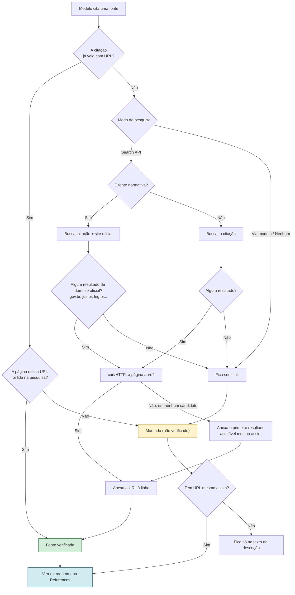
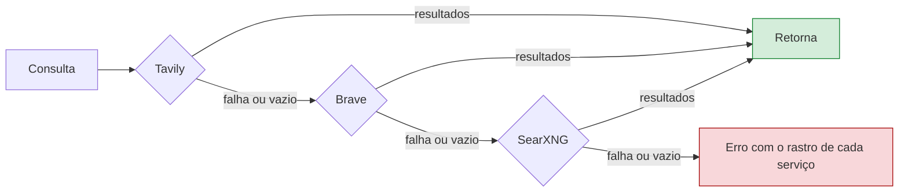
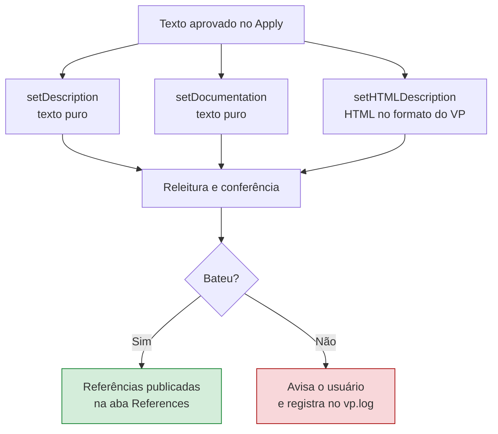

# Documentação de classes por Inteligência Artificial

Esta funcionalidade escreve — ou melhora — a documentação de uma classe do modelo, seguindo um
template fixo e apoiada em pesquisa na web, dando preferência a fontes oficiais.

A pesquisa tem duas etapas, e elas não se confundem: os **serviços de busca** servem para transformar
os termos da classe em páginas candidatas, e **cada página encontrada é então baixada** — por HTTP
direto e, quando isso não passa, por `curl` — para que o modelo trabalhe sobre o que a página diz, e
não sobre o trecho que o buscador escreveu para anunciá-la.

Acesso: botão direito sobre uma classe → **Document or improve documentation...**

O texto gerado vai para o campo *Description* da classe, e as fontes citadas que tenham URL viram
entradas na aba **References** do Visual Paradigm.

---

## 1. O template

A estrutura preenchida pela IA é configurável em *Settings → Prompts and decision tree → Edit prompts & decision tree… → Documentation*
(veja a [seção 6](#6-configuração)). O padrão fica em
[`src/main/resources/prompts/`](../src/main/resources/prompts/README.md), junto com os demais prompts da IA, e é:

```markdown
# {Nome da Classe}

## Descrição curta
{No máximo 40 palavras.}

## Descrição completa
{Tamanho livre.}

## Fontes Normativas
{Leis, Documentações Oficiais, Resoluções...}

## Fontes
{Blogs, Livros e Documentos explicativos}
```

Duas regras de formatação valem a pena registrar:

- **Seções de fontes vazias são removidas.** Se não houver fonte normativa defensável, o cabeçalho
  "Fontes Normativas" não aparece. O prompt pede isso, e o código remove o que sobrar.
- **O estereótipo OntoUML nunca aparece no texto.** Ele é enviado à IA como contexto para que ela
  entenda a natureza da coisa, mas o prompt proíbe citá-lo: o leitor é do domínio, não modelador.

---

## 2. O fluxo completo

```mermaid
sequenceDiagram
    actor U as Usuário
    participant VP as Visual Paradigm
    participant C as DocumentClassController
    participant W as DocumentClassWorker
    participant CB as LlmPromptContextBuilder
    participant F as WebPageFetcher
    participant LF as LocalFileFetcher
    participant D as DocumentExtractor
    participant S as WebSearchController
    participant L as LlmAccessController
    participant V as DocumentClassView

    U->>VP: botão direito → Document or improve documentation...
    VP->>C: performAction(contexto)
    C->>C: valida seleção única e provedor configurado
    C->>W: execute()

    Note over W: tudo abaixo roda fora da EDT,<br/>com diálogo de progresso cancelável

    W->>CB: buildDocumentationClassSummary(classe)
    CB-->>W: nome, estereótipo, atributos e<br/>descrição atual (íntegra)

    W->>CB: buildRelatedClassesSummary(classe)
    CB-->>W: vizinhas com descrição CURTA<br/>+ fontes normativas já citadas

    rect rgb(245, 245, 220)
        Note over W,L: Etapa RAG — lê as fontes citadas no modelo
        W->>CB: collectSources(classe)
        CB-->>W: referências da própria classe, das vizinhas,<br/>dos diagramas e dos pacotes acima
        loop até 12 fontes
            alt localizador é URL
                W->>F: retrieve(url) — curl direto, HTTP de reserva
                F-->>W: texto, documento convertido, ou o motivo
            else localizador é arquivo
                W->>LF: fetch(caminho)
                LF-->>W: texto, documento convertido, ou o motivo
            end
            opt é PDF, Word, Excel ou PowerPoint
                W->>D: extract(documento)
                D-->>W: Markdown (Docling) ou texto (pdftotext)
            end
            alt nada lido e modo Search API
                W->>S: findRetrievablePage(legenda + descrição)
                S->>F: fetch(candidato)
                F-->>S: texto de outra página com a mesma referência
                S-->>W: página alternativa lida
            end
            alt conteúdo obtido e curto
                W->>L: requestSourceSummary(conceito, fonte, conteúdo)
                L-->>W: resumo de 50 palavras focado na classe
            else conteúdo obtido e longo
                loop cada bloco de ~12k, até 8
                    W->>L: requestSourceSummary(..., "parte i de n")
                    L-->>W: resumo parcial
                end
                W->>L: requestSourceDigest(resumos parciais)
                L-->>W: resumo consolidado de 80 palavras
            else nada lido
                Note over W: a fonte entra no prompt como<br/>[not read] com o motivo — o modelo<br/>pode citá-la, sempre (não verificado)
            end
        end
    end

    opt modo Search API
        Note over W,F: a busca encontra as páginas;<br/>quem lê o texto é o fetcher
        W->>S: search(consultas do nome + projeto)
        S-->>W: candidatos (título, URL, trecho)
        W->>S: deduplicate + retrieve(candidatos)
        loop até 5 páginas
            S->>F: fetch(url)
            F-->>S: texto da página (≤ 2500 chars) ou null
        end
        S-->>W: candidatos com o texto lido<br/>(quem não abriu fica só com o trecho)
    end

    W->>L: requestDocumentation(prompt montado)
    L-->>W: template preenchido

    opt modo Search API
        W->>S: resolveUrl(fonte sem link)
        S->>F: fetch(candidato) — confirma que a página abre
        F-->>S: texto ou null
        S-->>W: URL oficial que foi lida, se encontrada
    end
    W->>W: remove seções de fontes vazias

    W->>V: mostra proposta ao lado da atual
    U->>V: revisa, edita se quiser, clica Apply
    V-->>W: wasApplied() = true

    W->>VP: setDescription + setDocumentation + setHTMLDescription
    W->>VP: addReference() por fonte com URL ou caminho de arquivo
    W->>W: relê e confirma a gravação
```

---

## 3. As classes envolvidas


---

## 4. Como uma fonte ganha (ou não) o selo de verificada

Esta é a parte sensível: um LLM inventa citações jurídicas plausíveis com facilidade. O fluxo abaixo
existe para que isso não aconteça silenciosamente.



Regras que o prompt impõe e que sustentam esse fluxo:

- Uma URL só entra em **Fontes Normativas** se apareceu nos resultados de busca fornecidos, ou se já
  era citada como normativa por uma classe relacionada — com preferência para aquelas cuja página
  foi efetivamente baixada e lida.
- Um resultado que o buscador listou mas cuja página **não abriu** vale como memória, não como
  fonte: o trecho do buscador é propaganda da página, escrita para casar com a consulta.
- Sem pesquisa configurada, **toda** fonte listada carrega `(não verificado)`.
- Ao reutilizar a fonte de uma classe vizinha, a marca `(não verificado)` é **carregada junto** — uma
  referência não se torna verificada por ter sido copiada.
- Anexar uma URL encontrada por busca **não remove** a marca: achar a página da lei confirma a
  *fonte*, não que o artigo diga o que o texto afirma.

---

## 5. Modos de pesquisa

| Modo | Quem pesquisa | Resolve URL faltante? | Observação |
|---|---|---|---|
| **No research** | ninguém | não | Toda fonte sai marcada como não verificada |
| **Search via the model** | o provedor | **não** | Só funciona onde há suporte (OpenRouter via sufixo `:online`, modelos Perplexity/Sonar). Em outros provedores o modelo responde de memória |
| **Search API** | o plugin | **sim** | Único modo com garantia de que a fonte foi realmente lida |

A divisão de papéis dentro do modo **Search API** é deliberada:

| Etapa | Quem faz | O que entrega |
|---|---|---|
| Encontrar páginas a partir dos termos da classe | os serviços de busca | uma lista de candidatos: título, URL e trecho |
| Ler o que a página diz | `WebPageFetcher` — HTTP direto e, se não passar, `curl` | o texto da página, sem marcação, até 2500 caracteres no prompt |
| Achar outra cópia de uma referência cujo link morreu | os serviços de busca, e o fetcher em seguida | uma página alternativa, também lida antes de ser usada |

O trecho devolvido pelo buscador **nunca** substitui a leitura da página: ele entra no prompt apenas
quando a página não abriu, e marcado como tal.

No modo **Search API** é possível habilitar vários serviços — **Tavily**, **Brave** e **SearXNG**
(auto-hospedado). Eles são tentados na ordem da lista e, quando um falha, dá timeout (20 s) ou volta
vazio, o próximo assume:



Cada tentativa vira uma entrada no **AI Conversation Log**, então dá para ver qual serviço respondeu
e com quê.

> **SearXNG:** a saída JSON vem **desabilitada por padrão**. É preciso incluir `json` em `formats:`
> no `settings.yml` da instância, senão ela responde HTML e a busca falha.

---

## 6. Configuração

*OntoUML Plugin → Settings*, grupo **LLM API Settings**. Cada botão de teste fica junto do que ele
verifica:

- **Enable LLM Integration** — a chave-mestra do grupo: desligada, esconde todo o resto (inclusive
  este grupo) e desabilita **Suggest Metaclass (AI)…** e **Document or improve documentation…** no
  menu de contexto de uma classe. Ligada por padrão, para quem já tinha um provedor configurado
  antes desta opção existir não perder a integração ao atualizar o plugin.
- **Provider / API key / Base URL** — endpoint compatível com OpenAI. Suporta OpenAI, Gemini,
  OpenRouter, Groq, Mistral, DeepSeek, Ollama e LM Studio (locais, sem chave), ou uma URL própria em
  *Other*. O botão **Test**, logo abaixo, envia uma requisição mínima com esses campos, como estão
  digitados (sem precisar salvar), e mostra o resultado ao lado.
- **Model** — um combo editável: digite o nome livremente, ou clique **Fetch models** para listar
  os modelos que o provedor oferece agora mesmo (`GET {Base URL}/models`, o mesmo endpoint que todo
  provedor da lista expõe ao lado do `/chat/completions`, com a mesma chave). O nome digitado é
  mantido mesmo que a busca falhe ou que o provedor não suporte esse endpoint — nesse caso o campo
  continua se comportando como antes, um texto livre.
- **Web research** — o modo da [seção 5](#5-modos-de-pesquisa), com os serviços e credenciais.
  **Test search** fica ao lado do modo escolhido e testa exatamente ele: com *Search API* roda uma
  consulta de exemplo nos serviços; com *Search via the model* **falha** se o provedor não devolver
  as páginas que consultou (veja abaixo). Fica **desabilitado** em *No research*, e os serviços de
  busca com suas próprias chaves só aparecem com *Search API* selecionado. Em ambos os modos que
  pesquisam, o teste **abre o AI Conversation Log** com o que foi enviado e o que voltou.
- **Prompts and decision tree** — o botão abre o editor dos textos enviados ao modelo. Na aba
  **Documentation** edita-se o *template* e o *prompt*, com **Restore defaults**. Salvar um texto
  idêntico ao padrão não grava customização, de modo que os padrões continuam evoluindo junto com
  o plugin.
- **Rate limiting** — a pausa entre chamadas ao modelo e o comportamento diante do erro 429, na
  [seção 12](#12-limite-de-requisições-do-provedor-http-429).
- **Reading sources that are not web pages** — a leitura de arquivos locais e a conversão de
  documentos, descritas na [seção 9](#9-fontes-que-nao-sao-paginas-web). Cada conversor tem o seu
  **Test**.

As ações **Suggest Metaclass (AI)…** e **Document or improve documentation…** do menu de contexto de
uma classe ficam **desabilitadas** enquanto o provedor não estiver configurado (uma chave de API
preenchida, exceto nos provedores locais). Elas voltam a valer ao salvar as configurações.

  Os arquivos padrão e o passo a passo de personalização estão em
  [`src/main/resources/prompts/README.md`](../src/main/resources/prompts/README.md).

---

## 7. Onde o texto é gravado

O Visual Paradigm mantém a documentação de um elemento em mais de uma propriedade, e a janela
*Specification* renderiza a versão **HTML** quando ela existe. Por isso a gravação escreve nas três:



Escrever apenas o texto puro funcionava em classes ainda sem documentação, mas deixava o texto
antigo na tela em classes documentadas dentro do VP — cuja documentação está armazenada como HTML.

---

## 8. Limitações conhecidas

- **Resolução de URL só no modo Search API.** Nos demais modos, o plugin depende do que o modelo
  devolver.
- **Teto de 12 fontes** por execução, entre as quatro origens — cada uma custa ao menos uma chamada
  de API, e um documento longo custa uma por bloco mais a consolidação. A ordem de coleta garante
  que as referências da própria classe nunca sejam as excluídas pelo teto.
- **Teto de 8 blocos** por fonte: um documento acima de ~96 mil caracteres é resumido a partir do
  começo.
- **Teto de 5 páginas lidas** por execução entre os resultados de busca, e de 3 candidatos abertos
  ao resolver a URL de uma citação: cada leitura é uma requisição HTTP.
- **Resultados de busca truncados em 2500 caracteres** quando entram no prompt. Isso não vale para
  as fontes citadas no modelo, que são lidas até 120 mil caracteres e resumidas em blocos.
- **Documentos dependem de um conversor instalado.** Sem Docling e sem `pdftotext`, um PDF não é
  lido — mas a fonte não desaparece: entra no prompt como citação declarada, com o motivo, e o que
  for escrito a partir dela carrega `(não verificado)`.
- **Docling não lê o que não é documento nem página**, e sua primeira execução baixa modelos de
  layout de algumas centenas de megabytes.
- **Referências internas do VP são ignoradas.** Uma referência de tipo Diagram, Shape, Model Element
  ou Folder aponta para dentro do modelo: não há documento a ler, e o que ela liga já está no prompt
  por outro caminho.
- **Sites que exigem JavaScript devolvem pouco.** O que se lê é o HTML servido, não a página
  renderizada — nesses casos a entrada fica com o trecho do buscador e a marca `(não verificado)`.
- **O `curl` é a via principal**, e onde ele não existir vale apenas a tentativa em processo:
  páginas que recusam o cliente Java ficam sem ser lidas.
- **O teste "via modelo" exige as páginas consultadas, não uma URL no texto.** Um modelo sem busca
  cita de memória uma página real (para uma lei conhecida, acerta a URL), então uma URL na resposta
  não prova nada. O teste só passa se o provedor devolver, junto da resposta, as citações que
  usou — `annotations` do tipo `url_citation` (OpenAI, OpenRouter) ou `citations`/`search_results`
  (Perplexity). Sem elas o teste falha e diz que o modelo não está pesquisando, como acontece com
  `gemini-flash-lite-latest`. Ao documentar uma classe nesse modo, uma resposta sem citações gera o
  mesmo aviso, porque as fontes vêm da memória do modelo.
- **Fontes sem URL nem caminho não viram referência.** Uma citação como `Lei 14.133/2021, art. 8º`
  sem link permanece apenas no texto: uma referência no VP precisa de um alvo, e inventar um seria
  pior.
- **A limpeza de seções vazias é aplicada à proposta exibida.** Se você editar o texto na revisão e
  reintroduzir uma seção vazia, ela é gravada como escrita.

---

## 9. Fontes que não são páginas web

Boa parte do material que importa não está numa página HTML. Está num PDF do Diário Oficial, numa
planilha anexa, num arquivo que o autor do modelo guardou ao lado do projeto. A aba *References* do
Visual Paradigm aceita os dois tipos — **URL** e **File** — e o plugin lê ambos.

### De onde vêm as referências

Quatro origens, lidas nesta ordem de prioridade:

| Origem | O que é | Como aparece no prompt |
|---|---|---|
| A própria classe | O que o autor anexou à classe que está sendo documentada | `origem: a própria classe` |
| Classes vizinhas | Pais, filhos e associadas | `origem: classe X` |
| Diagramas | Os diagramas em que a classe é desenhada | `origem: diagrama X` |
| Pacotes e modelo | Os contêineres acima dela | `origem: pacote X` |

A ordem não é decorativa. Fontes repetidas são lidas uma vez só e creditadas à origem mais próxima,
e o teto de 12 fontes por execução corta pelo fim — de modo que as referências da própria classe
nunca são as sacrificadas. O prompt diz ao modelo que, havendo contradição, a fonte da própria
classe prevalece.

Referências de tipo *Diagram*, *Shape*, *Model Element* e *Folder* são ignoradas: apontam para
dentro do modelo, não há documento a ler, e o que elas ligam já chega ao prompt por outro caminho.

### Como cada uma é aberta

- **URL** → `curl` direto (TLS e redirecionamentos próprios, que é o que faz publicadores oficiais
  responderem), com `HttpURLConnection` de reserva para a máquina sem curl.
- **Arquivo** → lido do disco, com o mesmo cuidado de *charset* dado a uma página: uma norma salva
  de um site antigo é windows-1252 tão frequentemente quanto UTF-8.
- **Documento** (PDF, Word, Excel, PowerPoint…), venha da web ou do disco → conversor externo.

### Os conversores

Nada disso é empacotado: o plugin publica apenas suas classes (`assembly/assembly.xml`), sem jars de
dependência, então uma biblioteca como o PDFBox não é opção. A conversão é delegada a um programa da
máquina:

| Conversor | Cobre | Como instalar |
|---|---|---|
| **Docling** (opt-in, desligado por padrão) | PDF, DOCX, XLSX, PPTX, HTML, imagens — converte para Markdown, preservando tabelas e seções | `pipx install docling` |
| **pdftotext** (padrão) | PDF com texto | `brew install poppler` / `apt install poppler-utils` |

Cada um tem um campo de caminho e um botão **Test** nas configurações. O teste não se contenta com
`--version`: converte um arquivo pequeno de verdade, porque o que quebra na prática é a forma de
invocação e a leitura do resultado, não a existência do programa.

> **Por que `pipx` e não `pip3`.** O Python do Homebrew recusa instalações globais (PEP 668). O
> `pipx` instala o Docling isolado e põe o executável em `~/.local/bin`, que é o primeiro diretório
> que o plugin sonda justamente por isso.
>
> **Por que o caminho é configurável.** O Visual Paradigm aberto pelo Dock ou pelo Finder no macOS
> **não herda o `PATH` do shell**. O `curl` funciona por morar em `/usr/bin`, mas `docling` e
> `pdftotext` vivem em `~/.local/bin`, `/opt/homebrew/bin` ou num *virtualenv* — e chamá-los pelo
> nome simples falharia sempre, com o usuário vendo o mesmo comando funcionar no terminal dele. O
> plugin sonda `~/.local/bin`, `/opt/homebrew/bin`, `/usr/local/bin`, `/opt/local/bin`, `/usr/bin` e
> `/bin`, além do `PATH` do processo; o campo existe para o caso que a sondagem não cobre.

O Docling é desligado por padrão de propósito: é um programa Python que o usuário precisa instalar,
e sua primeira execução baixa modelos de layout de algumas centenas de megabytes. O aviso disso
aparece uma vez por sessão no log, e a conversão tem *timeout* próprio (180s, configurável) — com
quatro vezes essa folga na primeira conversão da sessão, que é quando os modelos podem estar sendo
baixados. Medido aqui: 1min54 na primeira conversão de um PDF, contra ~15s nas seguintes.

### Documentos grandes

Um documento acima de ~12 mil caracteres não é truncado, como era antes — é resumido em blocos: cada
pedaço é resumido com a classe em foco, e os resumos parciais são consolidados num único de até 80
palavras. Numa norma, o que se perdia na truncagem eram justamente os artigos do fim, onde estão as
obrigações.

### Quando nada funciona

A fonte **não desaparece**. Ela entra no prompt como citação declarada, com o motivo:

```
- Resolução CNJ 325/2020  (origem: a própria classe)
  Arquivo: /Users/alex/normas/res-325.pdf
  [not read] PDF não convertido (Docling desligado nas configurações; pdftotext não encontrado em "pdftotext")
```

O modelo fica sabendo que a classe cita aquela norma e pode citá-la — mas não sabe nada do conteúdo,
então tudo que escrever a partir dela carrega `(não verificado)`. Antes desta mudança a fonte era
simplesmente descartada, e uma citação que o autor havia colocado ali de propósito sumia sem deixar
rastro.

---

## 10. Acompanhando e deixando em segundo plano

Documentar uma classe pode levar minutos: o plugin lê as fontes citadas, converte PDFs, pesquisa na
web e pergunta ao modelo mais de uma vez. A janela de progresso mostra em que ponto isso está.

### A janela

Cinco passos, na ordem em que rodam, cada um com seu estado:

| Marca | Estado |
|---|---|
| `○` | ainda não começou |
| `▶` | em andamento (em negrito, com o contador `3 de 12` quando há um) |
| `●` | concluído |
| `–` | não foi necessário, com o motivo abaixo |
| `×` | falhou, com o motivo abaixo |

| Passo | Quando é pulado |
|---|---|
| Contexto do modelo | nunca |
| Leitura das fontes citadas no modelo | quando nem a classe nem o que a cerca cita referências |
| Pesquisa na web | com a pesquisa desligada, ou feita pelo provedor do modelo |
| Geração da documentação pelo modelo de IA | nunca |
| Links das fontes citadas sem endereço | fora do modo Search API |

Abaixo da lista, uma linha diz o que o passo em andamento está fazendo *agora* — `Baixando com curl`,
`Convertendo PDF com Docling`, `Resumindo "Lei 14.133" — trecho 4 de 24 (3 de 8 escolhidos por
relevância)`, `Aguardando gemini-flash-lite-latest` — e a barra fica determinada quando há
denominador. Na primeira conversão com o Docling da sessão, a linha avisa que ela pode levar alguns
minutos, que é quando os modelos de layout estão sendo baixados.

As mesmas janelas servem a *Suggest Metaclass (AI)* e aos serviços do servidor OntoUML (verificação,
modularização, exportação), com um passo só.

### Segundo plano

- **Continuar em segundo plano** fecha a janela sem interromper a tarefa. O botão de fechar da
  janela faz o mesmo: ele nunca cancela — cancelar joga o trabalho fora, e isso exige o botão
  **Cancelar**.
- Enquanto a tarefa roda sem janela, o andamento é escrito numa linha do painel de mensagens do VP,
  atualizada no lugar (não se acumulam `3 de 12`, `4 de 12`…).
- Quando termina, o diálogo de resultado aparece como sempre.
- **OntoUML Plugin → Running Tasks** reabre a janela de uma tarefa em andamento, com o **Cancelar**.
  O item fica desabilitado quando não há nada rodando e mostra quantas há: `Running Tasks (2)`.

O painel de mensagens acumula as linhas do plugin (até 300). Antes, cada mensagem substituía a
anterior, e um aviso de fonte não lida sumia com a mensagem seguinte.

---

## 11. Modo debug

*Settings* → **Debugging**. Ligado, ele:

- tira o teto de 25 entradas do *AI Conversation Log* (vai a 500 em memória);
- grava **todas** as trocas em disco, uma arquivo por sessão, na ordem em que aconteceram.

Por padrão, em `<workspace do Visual Paradigm>/ontouml-ai-logs/ontouml-ai-<AAAAMMDD-HHMMSS>.log` — a
mesma pasta do `.ontouml.config.json`. A pasta pode ser trocada, e o caminho efetivo aparece na tela
de configurações.

Fica desligado por padrão porque um prompt carrega o seu modelo, e gravá-lo em arquivo deve ser uma
decisão sua.

O que entra no log, além das chamadas ao modelo: uma entrada **Source retrieval** por fonte lida,
com o rastro da recuperação — qual cliente rodou (`curl`, `HttpURLConnection`), o *content-type* e
o tamanho recebidos, qual conversor respondeu (`Docling`, `pdftotext`) e em quanto tempo. É o que
distingue "a página não existe" de "a ferramenta não rodou neste processo".

---

## 12. Limite de requisições do provedor (HTTP 429)

Documentar uma classe faz uma chamada por fonte lida, uma por bloco de um documento longo, e a da
própria documentação. Num provedor cujo plano gratuito permite poucas requisições por minuto, isso
basta para ser recusado — e jogar fora uma execução inteira porque a décima terceira chamada chegou
um segundo cedo seria um desperdício.

### O que acontece num 429

O plugin **espera 30 segundos e envia a mesma requisição de novo**, até **3 vezes**. A espera é
contada regressivamente na linha de atividade da janela de progresso (`O provedor limitou as
requisições (HTTP 429) — nova tentativa 2 de 3 — 27s`), pode ser cancelada a qualquer momento, e cada
espera vira uma entrada no *AI Conversation Log* (`Rate limit (HTTP 429) — waiting 30s, retry 1 of 3`),
de modo que dá para ver depois por que uma execução demorou.

Duas exceções, ambas deliberadas:

- Se o provedor manda `Retry-After` **maior que 30 s**, essa espera é respeitada (até 120 s):
  tentar antes só levaria a outra recusa. Um `Retry-After` menor não encurta os 30 s.
- Se o `Retry-After` passa de **120 s**, o plugin **não espera**: um 429 que pede minutos ou horas é
  cota esgotada (a diária também responde 429), não ritmo alto demais, e esperar não a devolve. O erro
  é mostrado na hora.

Qualquer outro erro (chave inválida, modelo inexistente) continua sendo mostrado na hora: tentar de
novo só atrasaria a mensagem. Os botões **Test** das configurações também não repetem — quem os
clica quer saber o que houve, não olhar "Testing…" por um minuto e meio.

### Pausa entre chamadas (opt-in)

*Settings* → **Rate limiting** → **Wait between calls to the model**, desligado por padrão, com o
número de segundos configurável (1 a 300; padrão 5). Ligado, o plugin espera esse tempo **depois de
cada chamada** antes de fazer a seguinte, e o tempo que o próprio trabalho já gastou entre uma e
outra é descontado — a pausa é um mínimo, não um acréscimo.

Serve para *evitar* o 429 em vez de esperá-lo: com um limite de 5 requisições por minuto, uma pausa
de 12 s mantém o ritmo abaixo do teto e a execução nunca chega a ser recusada. As duas coisas são
independentes e se somam quando ambas são necessárias.
